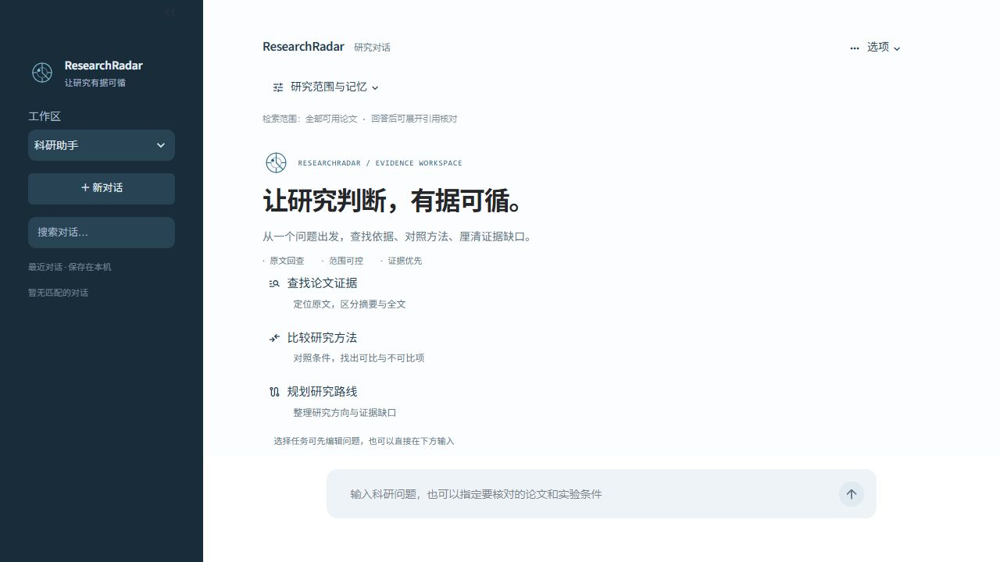

# 水色遥感预测科研助手

检索更新（2026-10-28）：新增有界双语词法要点分支与排名融合；旧 48 题排名保持一致，中文开发试点指定证据覆盖从 25% 变为 41.67%。对照范围、兼容性取舍及替代证据审查见[双语检索设计](docs/BILINGUAL_RETRIEVAL_20261028.md)。

证据更新（2026-10-28）：新增 8 条开发标注、原页/证据指纹校验和来源分组泄漏检查；6 条证据题的原始关键词覆盖基线与限制见[任务证据试点](docs/EVIDENCE_PILOT_20261028.md)。该试点不是独立留出集。

框架更新（2026-10-27）：Skill 1.1 区分证据不足、策略拦截和运行失败，避免异常触发错误的通用兜底；高星项目对标、执行契约与演进计划见[框架演进设计](docs/FRAMEWORK_EVOLUTION_20261027.md)。

2026-10-27 更新：研究工作区采用墨蓝导航、雷达标识和纵向任务入口，精简控件描边并适配不同版本控件。见[视觉识别设计](docs/VISUAL_IDENTITY_20261027.md)。任务草稿、对话导出与按需初始化见[交互与依赖设计](docs/DESKTOP_REFINEMENT_20261027.md)，引用导航与范围校验见[证据工作区设计](docs/EVIDENCE_WORKSPACE_20261027.md)。



截图为关闭模型服务的本地工作区。桌面启动见[桌面便携版](docs/DESKTOP.md)，语料质量限制见[核心全文试点](docs/CORE_FULLTEXT_PILOT_20261022.md)，历史变更见[分批记录](docs/RELEASE_BATCHES_20261026.md)。

一个面向水色遥感与水质参数预测的本地科研助手。项目将合法开放文献摄入、证据型 RAG、受控 Agent 和可复现评估串成一条完整链路，重点是回答可回查、失败可解释、运行边界清晰。

## 核心能力

- 从 OpenAlex 发现候选文献，并通过 Crossref、Unpaywall、CORE 和可选的 Semantic Scholar 解析合法开放全文。
- 对下载内容做 PDF 校验，按页解析和切分证据块，保存到 SQLite/FTS5 与 FAISS。
- 使用关键词、向量和 Weighted RRF 混合检索，保留 `paper_id`、`chunk_id`、页码和原文引用。
- 通过有界 LangGraph Agent 路由到两个受控技能：证据问答和研究路线。
- 提供 Streamlit 工作台、知识库维护、文献状态查看、任务日志和数据源健康检查。
- 提供 retrieval-only 和引用链路评估，不把离线检索指标包装成线上问答准确率。

## 架构

```text
文献查询 -> OpenAlex 发现 -> 元数据校正 -> 合法 OA 全文解析
                                      |
                        SQLite/FTS5 + FAISS 证据索引
                                      |
                       混合检索 -> 引用校验 -> Agent 输出
                                      ^
                         受控路由 -> 证据问答 / 研究路线
```

Agent 只负责意图识别、查询改写和技能选择。下载、去重、索引、引用校验和失败处理由确定性后端控制，不把版权边界或事实判断交给模型自由决定。

## 安装

推荐 Python 3.12：

```powershell
python -m venv .venv
.\.venv\Scripts\Activate.ps1
pip install -r requirements.txt
Copy-Item .env.example .env
```

复制 `.env.example` 后填写自己的凭据。对话模型和本地 Embedding 分开配置：默认 Embedding 使用 `BAAI/bge-m3`，不依赖远程 Embedding API。`.env`、数据库、PDF、向量索引、报告和缓存均不会提交到 Git。

## 常用命令

```powershell
# 检查外部数据源配置
python app.py provider-health

# 建立或增量更新本地知识库
python app.py seed --config config/seed_queries.yml
python app.py stats
python app.py knowledge-audit --json

# 查询和维护
python app.py ask "哪些传感器用于叶绿素 a 预测？"
python app.py retry-fulltext --limit 20
python app.py profile-abstracts --limit 100
python app.py rebuild-index

# 离线评估
python app.py evaluate --dataset data/evaluation/questions-annotated.jsonl --retrieval-only
python app.py evaluate-answers --dataset data/evaluation/answers-annotated.jsonl

# 启动工作台
streamlit run web/app.py
```

`data/evaluation/questions.jsonl` 是带占位符的注释模板，不能直接当作评测结果；`questions-annotated.jsonl` 是当前随仓库提供的本地证据组样例。重新摄入论文后，应重新核对真实的 `paper_id` 和 `chunk_id`。

## 验证与 CI

仓库通过 GitHub Actions 在 `main` 推送和 Pull Request 时使用 Python 3.12 执行依赖安装、离线 healthcheck、静态编译和自动化测试。CI 不调用模型或真实 provider，因此它验证的是可重复的本地逻辑与数据契约，不替代外部数据源联调。

本地提交前可执行：

```powershell
python scripts/healthcheck.py
python -m compileall -q agent domain evaluation ingestion model providers rag retrieval storage web workflows
python -m pytest -q
```

真实演示前还应运行 `python app.py provider-health`，并在实际论文语料上确认引用回查与证据不足 fallback。不要将固定语料的离线指标或一次测试结果表述为线上模型准确率。

## 工作台页面

侧边栏包含七个入口：

- `科研助手`：连续对话、证据问答、研究路线和运行诊断。
- `知识库`：查看目录、证据层级和分布统计。
- `文献库`：按标题、DOI 和状态筛选文献。
- `研究方案`：基于本地证据生成带引用的起步路线。
- `知识库维护`：执行同步、画像、索引重建和一致性审计。
- `任务与日志`：查看同步任务的状态和计数。
- `数据源设置`：执行有界、脱敏的数据源健康检查。

## 证据和安全边界

- 只使用明确可合法开放访问的文献，不绕过付费墙、登录或订阅限制。
- 模型返回的引用必须经过本地 chunk store 回查，校验论文、页码和 quote；无效引用会被丢弃。
- 页码为 `0` 的内容会标记为摘要证据，不冒充 PDF 页码。
- 证据不足时返回明确的 fallback，通用解释不会伪造本地论文引用。
- 日志、健康检查和评估报告只输出稳定状态、计数和耗时，不输出密钥、邮箱、URL、绝对路径或模型原始输出。

## 评估口径

评估数据集使用 evidence groups：同组 chunk 可以互相替代，不同组代表必须覆盖的独立事实。报告可以比较 keyword、vector、hybrid 和 two-stage 的 Evidence-group Recall@5、MRR 与 Paper Recall@5，并记录检索 trace 和延迟。

这些指标只反映当前本地语料和标注版本的离线检索表现，不等于通用领域准确率，也不等于线上生成式问答质量。`evaluate-answers` 只检查人工整理样本的引用链路，不替代真实模型回答评测。

## 已知限制

- 扫描版 PDF、复杂表格和公式尚未接入 OCR 或版面级解析。
- 全文覆盖受合法开放地址和仓储稳定性影响，元数据数量不等于全文数量。
- 单机项目不提供多用户权限、云端部署或自动执行实验。
- 评估标注随本地论文版本变化；论文重新摄入或去重后，需要重新核对证据 ID。

## 项目结构

```text
agent/       受控 Agent 与技能注册
domain/      Pydantic 数据契约
evaluation/  数据集、指标和报告
ingestion/   文献下载、解析和摄入
providers/   OpenAlex、Crossref、OA 全文 provider
rag/         FAISS 向量存储
retrieval/   FTS5、向量和混合检索
storage/     SQLite 数据库与路径
web/         Streamlit 工作台
workflows/   QA、研究路线、画像和维护流程
tests/       自动化测试与 provider fixtures
```

运行前请阅读 [docs/GITHUB_PUBLISHING.md](docs/GITHUB_PUBLISHING.md) 和 [docs/demo/research-workbench-demo-checklist.md](docs/demo/research-workbench-demo-checklist.md)。
