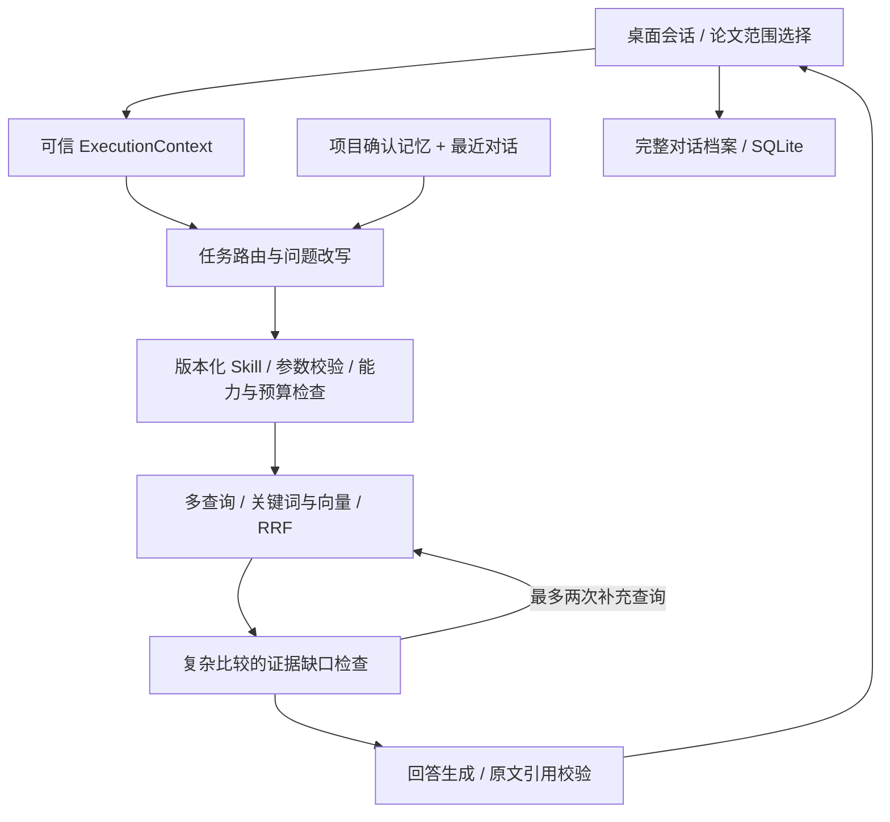

# 第二轮架构复盘与实现（2026-10-22）

这次重点解决上下文正确性、可控记忆、检索退化和桌面会话管理。当前是单用户本地应用，桌面窗口使用 pywebview 承载 Streamlit。以下区分已实现与后续建议，不能把功能改动直接视为召回率提升。

## 当前链路

图中的回路受代码预算限制，并非无限循环。Planner、证据 Reviewer、Writer 是任务角色；目前没有开放式多 Agent 自主协商。

## 已实现

| 层 | 发现的问题 | 当前处理 |
|---|---|---|
| RAG | 任一召回后端异常可能丢掉另一后端的有效证据 | 关键词、向量分支独立退化；全部失败返回固定错误；最终再次过滤显式论文范围 |
| RAG | 补充检索未计入总诊断 | 合并两轮查询数、候选去重、选中块、耗时和预算状态；两阶段可选全局分支失败保留短名单证据 |
| 权限 | 研究主题和访问范围容易混淆 | UI 显式论文选择传入可信 ExecutionContext；空选择为零访问；模型 scope_updates 不改变访问权限 |
| 记忆 | 清空字段后旧 provenance 仍会带回模型 | 确认范围时同步替换字段和来源；清空 sensor 会移除旧 sensor fact |
| 会话 | 最近 8 条模型上下文等同于可见历史 | SQLite 独立保存完整 transcript 和有界 state；支持新建、标题搜索、切换 |
| 遗忘 | 缺少可执行的记忆管理 | 忘记本次上下文保留可读档案，但重置 messages、summary、scope；项目记忆另有确认保存与清除 |
| 前端 | 维护导航占据侧栏，对话主线不清楚 | 紧凑工作区选择、历史侧栏、底部输入框、按需展开记忆和检索范围，保留文献库等业务页面 |

档案位于 `data/desktop/conversations.sqlite3`；环境变量 `RESEARCH_CHAT_DB` 可指定独立文件。完整档案不会整体传给模型。新对话仍能使用用户确认的项目记忆。论文选择属于当前 UI 会话，切换对话后重置，避免把旧范围误用于新任务。历史中不会恢复之前版本已经裁掉的消息。

## 权限与工具设计

- 用户选择的 `paper_ids` 是范围约束；配置中的自动核心论文 shortlist 是召回优化，两者语义不同。后者可回退扩大候选，前者始终约束检索和邻块加载。
- Skill 限制技能集合、数据范围、输入 schema、工具次数、模型次数；同一请求共享逻辑检索预算。一个混合检索内部仍会调用两个后端，因此逻辑检索次数不等于外部 HTTP 次数。
- 外部论文内容和历史记忆只能提供事实，不能改变允许执行的技能、论文范围或预算。引用校验确保引用定位及原文存在，尚不等于证明结论被原文语义支持。
- 超时是阶段边界检查，不能强制取消已经发出的模型请求；需进一步统一 provider timeout、取消信号和计费统计。
- 当前项目记忆是单一默认项目的本地记忆，不是多租户权限系统。提供多人服务之前必须增加真实身份认证、project_id 全链路隔离及服务器端授权。

## 下一步优先级

1. **真实召回评测**：把真实失败问题分成术语不匹配、跨论文比较、表格/OCR 缺失、证据已召回但排名低、引用不足五类。固定训练/调参集和留出集，报告 Recall@20、最终上下文 Recall@8、nDCG、引用正确率、耗时和成本，比较 BM25、向量、融合、补充检索各自贡献。
2. **证据粒度与重排**：先改进标题/章节/表格父子块、稳定文献标识和页码，再在有标注验证集上决定是否增加 reranker。扩大召回范围和提升最终排序要分别测量。
3. **持久化任务**：引入有界 Job 状态机，记录 request_id、取消、失败原因和恢复点，检索/分析进度通过事件传给 UI。完成后再扩展独立检索与评审 Agent，避免重复付费和交叉修改共享状态。
4. **记忆质量**：增加项目选择、逐条编辑、来源消息指针和冲突解决；不把模型推断直接写成已确认事实。长对话档案改为消息行表与分页，避免单条 JSON 随历史增长。
5. **原生交互**：把服务边界从 Streamlit 页面抽离，增加流式输出、停止生成、重试、快捷键和会话导出，再评估独立前端迁移。当前并未实现完整 ChatGPT 桌面客户端的全部能力。

交互参考：[ChatGPT 的会话、项目与文件查找说明](https://help.openai.com/en/articles/10056348-finding-your-chats-projects-and-files-in-chatgpt)。参考的是会话导航与按需展开的信息组织，不依赖其私有实现。

## 验证

本轮完整测试 352 通过、1 跳过；独立便携 Python 的 UI 冒烟通过。Windows 沙箱在测试结束清理临时目录时出现权限提示，pytest 主进程返回成功。

新增跨重启档案、会话隔离、遗忘上下文、UI 新建/切换、空论文范围透传、双后端退化、记忆字段撤回及多轮检索统计回归。离线测试及本机浏览器检查不代表真实模型回答质量提升；本轮没有重新跑真实论文召回基准，也没有进行付费模型调用。
