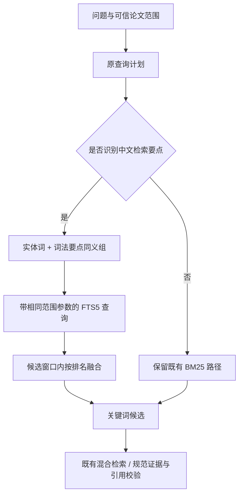

# 有界双语关键词检索与对照结果

日期：2026-10-28。查询层采用确定性词法计划，不增加模型调用、Agent 数量或运行依赖。

## 1. 分层设计

`retrieval/lexical_plan.py` 识别光谱、采样间隔、不确定性、大气校正等有限要点，提供英语检索词组，并保留原文出现的 ASCII 实体词。最多 6 组要点和 8 个实体词；不会因为出现“传感器”而新增原问题未指定的卫星名或数值。

要点组内是同义词 OR，组间与实体词使用 AND；严格查询为空时，最多放宽一次要点组合，但不改调用者提供的 paper_ids。显式空范围直接返回，不发 SQL。词法实体条件是相关性策略，权限边界仍是可信论文 ID 范围。

原查询保留以提供召回，聚焦分支不加入泛化的“method dataset metric evidence”填充词。焦点查询与原查询的 BM25 数值不直接比较，使用排名融合。配置为 rank_constant=60、聚焦权重 2、原查询权重 1。

候选窗口为 min(100,max(k,20))，融合后再截断到 k。最多 5 个分支，每分支最多 2 次 SQL（含宽松回退），共不超过 10 次；这是一次逻辑检索内部的本地 SQL 工作量，不另算成模型或网络调用。

参考：[SQLite FTS5](https://www.sqlite.org/fts5.html) 的匹配、列与排名接口，以及 [RRF 官方说明](https://www.elastic.co/docs/reference/elasticsearch/rest-apis/reciprocal-rank-fusion) 的跨结果集排名融合。项目继续使用 SQLite，没有迁入 Elasticsearch。

## 2. 为什么保留兼容路径

最初将新的合并方式扩大到一般查询后，旧 48 题证据组 Recall@5 从 65.625% 变为 64.5833%。因此本批将新融合限定在识别到中文要点的查询；未识别要点的一般查询保留旧 BM25 选择方式。

这也意味着本批没有解决所有旧查询分支之间的分数可比性问题。后续需要单独的来源分组评测，才决定是否迁移兼容路径。

## 3. 同语料同题集对照

| 范围与指标 | 修改前 | 最终方案 |
| --- | ---: | ---: |
| 旧 48 题证据组 Recall@5 | 65.625% | 65.625% |
| 旧 48 题证据组 Recall@20 | 81.25% | 81.25% |
| 中文试点 6 题指定证据块平均覆盖@5 | 25.00% | 41.6667% |

旧 48 题的排名也逐题核对一致；语料、题集与规范证据指纹一致。中文试点仍有多题未命中原指定段落；结果不是独立留出集收益、穷尽相关证据的召回率、混合/向量检索效果或线上回答准确率。

汇总与逐题对照：`artifacts/bilingual_retrieval_comparison_20261028.json`，含基线提交、当前代码指纹、配置、分母和兼容性取舍。原 8 题数据与冻结清单保持不变。

## 4. 替代证据核查

再次视觉核对 LAGOS-US PDF 第 1 页及 GLORIA PDF 第 7 页：

- LAGOS-US 的摘要段落可作为六变量列表问题的替代证据。
- GLORIA 的数据文件表含相关波长列名，但不能单独覆盖完整征集方法与质量保证条件，记录为相关的部分证据。

结果单列在 `artifacts/evidence_candidate_review_20261028.json`，保留短引、页码及正文/PDF 指纹；没有把它们加入本批分数，也没有通过修改原金标准抬高指标。检查的其他候选文本未覆盖指定事实，不代表全文不存在其他有效证据。

## 5. 验证和限制

新增 7 项回归，覆盖不同命名数据集的双语检索、错误 BM25 数值量级、候选/SQL 上限、查询语法与范围参数、空范围诊断重置、英语路径兼容，以及不凭翻译创造卫星名。

本地全量 437 项通过、1 项目录符号链接环境跳过；新增/修改模块和测试 E4/E7/E9/F/I、编译及健康检查通过。保留一条既有第三方弃用提示。KeywordTrace 只记录模式、计数和状态，不含原问题或 SQL 文本。

当前规则不能完成任意翻译、否定约束理解或语义相关性认证；未识别的中文要点仍会漏检。关键词分支变化会进入既有混合检索，但本批没有真实向量/重排/回答对照，不能据此宣布完整 RAG 效果改善。
