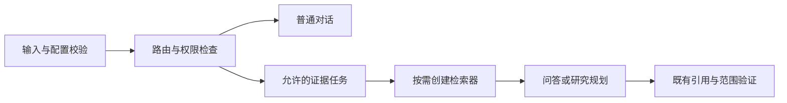
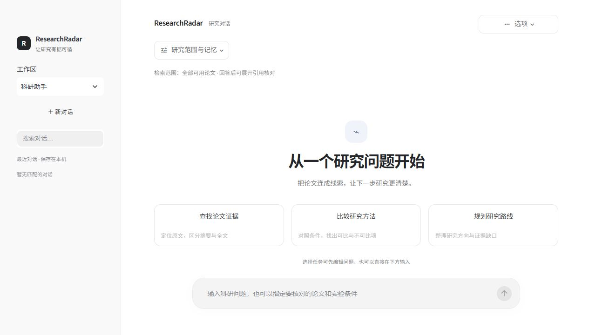

# 桌面界面、任务草稿与依赖初始化

日期：2026-10-27，接续同日证据工作区优化。

## 交互改进

采用轻侧栏、居中消息区域、底部输入、任务说明卡及统一的选项菜单。独立 `web/desktop.css` 使用本地样式，保留原生控件键盘交互、可见焦点和减少动画偏好；修正首次打开页头被自动滚动遮挡、长标题溢出等问题。仍使用 Streamlit 与既有桌面启动器，不宣称完成原生前端迁移。

- 查找证据、比较方法、规划路线先生成可编辑草稿，明确发送才执行；空草稿阻止提交，取消不调用后端，新建或切换会话清除旧草稿。发送失败保留编辑内容。
- 输入与草稿上限与 Agent 的 4,000 字符契约一致。
- 检索范围显示在设置外，选定论文为零时明确提示不检索，避免把空范围误当成全库。
- 支持完整对话 Markdown 导出，包含历史回复及各自引用，沿用原有转义、路径和敏感内容隐藏；不导出内部记忆和完整论文。

## 实际入口发现与修复

浏览器使用关闭模型凭据的真实 DefaultUiServices 发现：原 `DefaultServices.research_chat` 会在普通对话前初始化向量模型和研究工作流，之后才因缺少模型凭据报错。先前隔离 AppTest 使用替代服务，没有覆盖这个依赖组合问题。

现在先校验输入与模型配置，再构造请求级的惰性工作流。缺少配置时给出明确提示，不初始化数据库、模型客户端或向量模型；配置有效时，普通聊天不加载证据依赖，只有被 SkillExecutor 允许的证据任务才创建对应问答或研究规划服务。

`LazyResearchWorkflow` 保留 `paper_ids` 和补充查询参数，诊断读取不会触发初始化；已有权限检查、工具预算、引用验证与检索逻辑继续生效。惰性实例只属于当前请求，不跨用户缓存模型或检索范围。

## 验证与限制

新增检查覆盖任务编辑、空草稿、取消、新建清理、完整导出转义、空范围提示、配置缺失保留草稿；真实组合测试验证普通聊天不创建向量模型、仅创建选中工作流、显式空论文范围完整传递、权限拒绝发生在惰性初始化之前。

本地全量 387 项通过、1 项目录符号链接环境跳过；健康检查与新模块 Ruff 通过。仍有一条第三方弃用提示。

使用替代模型验证依赖构造和权限契约，不代表真实模型效果或召回率提高。知识补全、实验条件与表格证据标注、跨论文结构化比较仍待推进。

