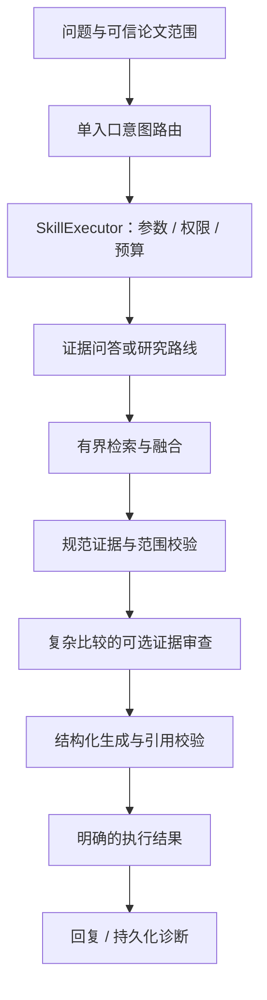

# ResearchRadar：有界证据工作流与执行结果契约

日期：2026-10-27。本批完善执行与失败语义，不修改语料、索引或界面，不宣称检索召回和模型回答质量提升。

## 1. 高星项目对标

访问时 GitHub 页面近似显示 LangGraph 44.0k、Dify 159.7k、RAGFlow 93.0k stars。星数用于筛选调研对象，不证明本项目应该照搬其架构。

| 官方来源 | 借鉴点 | 在 ResearchRadar 中的落点 |
| --- | --- | --- |
| [LangGraph 重试/超时源码](https://github.com/langchain-ai/langgraph/blob/main/libs/langgraph/langgraph/types.py) | 有边界的执行和明确的超时语义 | 继续使用固定图，策略拒绝必须穿过各层兜底，截止后不接受迟到输出 |
| [Dify 错误处理](https://docs.dify.ai/en/cloud/use-dify/build/predefined-error-handling-logic) | 成功输出、默认值与失败分支分别处理 | Skill 结果区分证据不足、运行失败和策略拦截；只有证据不足可走通用解释 |
| [RAGFlow 官方说明](https://github.com/infiniflow/ragflow#readme) | 多轮检索、分块审查与可回查引用 | 延续现有有界查询融合、规范证据校验；优先补语料和独立评测，不迁入整个平台 |
| [LangGraph 持久化](https://docs.langchain.com/oss/python/langgraph/persistence) | 会话 checkpoint 与长期 store 分工 | 当前持久化保留对话、用户确认研究范围及事实来源；未新增可恢复后台任务 |

本批自主实现适合现有代码的边界契约，没有复制上述项目的源码或增加新的运行依赖。

## 2. 保留的架构

审查器只提议缺口和补充查询，没有独立工具权限、循环或可写记忆，因此不把它包装成一套自主多 Agent 系统。后续跨论文结构化比较应先建立可比条件和证据契约。

## 3. 本批结果契约：Skill 1.1

| 状态 | 含义 | 是否允许触发通用回答兜底 |
| --- | --- | --- |
| success | 工作流完成并返回其有效结果 | 不因该状态触发 |
| insufficient_evidence | 检索/工作流正常完成，但现有证据不足 | 允许，仍受共享模型预算和截止时间控制；明确无本地论文背书 |
| blocked | 权限、范围、预算或截止时间阻止继续 | 不允许 |
| invalid_input | Skill 参数未通过验证 | 不允许 |
| failed | 提供方、检索或输出解析等执行失败 | 不允许 |

补充稳定错误码：skill_input_invalid、skill_handler_unavailable、retrieval_failed、model_failed，并保留既有策略错误码。未知异常只返回 research_skill_failed，不把提供方异常正文或密钥写入用户提示。

运行失败不等于语料缺失。失败提示改为“任务暂时未能完成，本次未判定知识库证据是否充足”。

领域结果 CitedAnswer/ResearchPlan 增加可选 execution_error；SkillExecutor 消费该信号，把工作流错误转换成失败结果，不把它当成一次正常的无证据回答。直接调用服务的旧调用者仍可读取原有 evidence_sufficient=false。

AgentDiagnostics 增加 execution_status / execution_error，随对话消息保存。旧记录没有这些字段时读取为 unknown，避免给历史失败补出虚假的 success。

## 4. 策略拒绝不能被普通异常处理吞掉

此前 QA、研究路线、证据审查和路由中的宽泛异常处理，可能把 ExecutionDenied 转成空结果或证据不足，之后继续通用模型回答。

现在分别处理：

1. 路由模型没有额度：在模型调用前停止，不进入规则路由或后续工作流。
2. 初始检索、生成或审查遇到策略拒绝：向执行边界传播，并返回 blocked。
3. 已获得部分检索结果后，只有 search_calls_exhausted 可以停止查询扩展并保留已有证据；它不授予新的模型预算。
4. 可选补检索耗尽搜索额度时可保留初始证据；deadline、范围拒绝或其他策略错误不能这样降级。
5. 路由模型、Skill 和通用回答返回后，再检查截止时间，拒绝迟到结果。

这里的截止检查不是硬取消：正在同步执行的 SDK 或检索不能被本批代码强制打断。所有网络超时仍应由相应提供方客户端配置。

### 超时摘录的既有行为

QA 模型超时且有足够规范块时，保留既有“原文摘录”降级，返回经过原文核对的摘录，不把它称为成功生成了研究结论。若摘录降级也无法成立，输出带 model_failed，不能伪装成正常检索后证据缺失。

引用原文匹配仍不等于结论语义支持已认证，本批不改变该限制。

## 5. 验证

新增 22 项测试，覆盖真实 QA/研究路线服务在搜索、生成、审查和补检索阶段的策略传播，运行错误与正常空检索的区别，迟到输出，历史记录兼容，以及完整 Agent 的兜底行为与持久化诊断。

本地全量 409 项通过、1 项目录符号链接环境跳过，健康检查及本批文件的 E4/E7/E9/F 静态检查通过；一条既有 langchain-community 弃用提示。测试使用替代模型和检索器，不进行真实付费模型、embedding 或语义支持评测。

现有显式空论文范围、论文范围不可由 Skill 参数扩展、按需初始化、上下文预算与规范引用校验继续由既有回归保护。

## 6. 下一阶段

| 顺序 | 方案 | 验收条件 |
| --- | --- | --- |
| 1 | 针对任务缺口补全文、章节与表格关系 | 核对原页，区分字符提取和关系可回答，不用块数冒充语料质量 |
| 2 | 标注并冻结独立的证据任务集 | 绑定完整/部分/缺失答案和证据；按来源、模板分组避免泄漏 |
| 3 | 结构化跨论文比较 Skill | 数据集、划分、指标、实验条件各自有来源；不可比时明确说明 |
| 4 | 同语料的真实检索与重排对照 | 报告 Recall/MRR、范围遵守、引用有效性、拒答、耗时和费用 |
| 5 | 研究长任务的持久执行状态 | 有真实中断恢复需求再引入 checkpoint；重放检索与外部写操作分别设计 |

只有独立证据分支能被安全并行、质量提升可重复且成本可接受时，才考虑多 Agent。当前检索器和 SQLite 使用可变请求状态，不直接并发共享实例。
